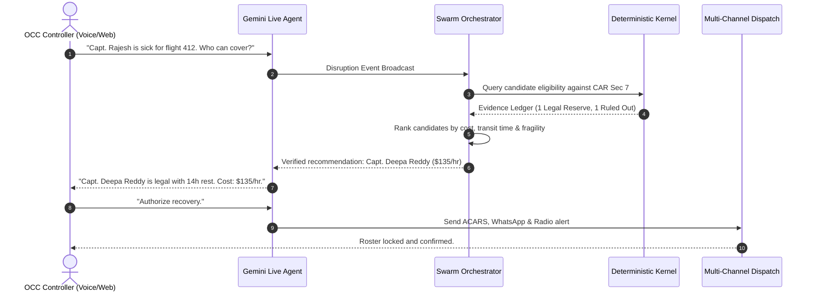
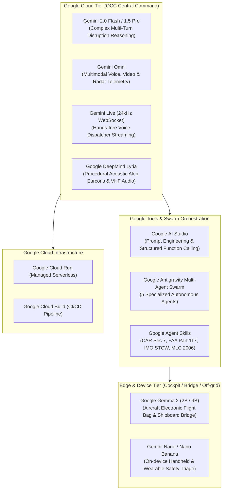

# CrewOps · System Architecture & Engineering Specifications

This document outlines the end-to-end technical architecture of **CrewOps**, designed for enterprise scale and multi-vertical mission-critical operations.

---

## 1. High-Level System Architecture

```
[ Field Radio / Dispatch Headset / Web Browser ]
                       │
       (WebSocket: 24kHz Bi-directional Audio)
                       ▼
┌────────────────────────────────────────────────────────────────────────┐
│                   GOOGLE CLOUD RUN EDGE (FastAPI Core)                 │
│                                                                        │
│   ┌──────────────────────────────────────────────────────────────┐     │
│   │               GEMINI LIVE STREAMING SESSION                  │     │
│   │   • Voice Activity Detection (VAD)                           │     │
│   │   • Real-time speech tokenization                            │     │
│   │   • Native OCC Tool Calling Parser                           │     │
│   └──────────────────────────────┬───────────────────────────────┘     │
│                                  │ (Typed Operational Intent)           │
│                                  ▼                                     │
│   ┌──────────────────────────────────────────────────────────────┐     │
│   │             ANTIGRAVITY MULTI-AGENT SWARM ORCHESTRATOR       │     │
│   │                                                              │     │
│   │   [ Incident Commander ] ──▶ [ Compliance Kernel Agent ]     │     │
│   │             │                          │                     │     │
│   │             ▼                          ▼                     │     │
│   │   [ Resource Optimizer ] ──▶ [ Dispatch Comms Agent ]        │     │
│   │                                        │                     │     │
│   │                                        ▼                     │     │
│   │                              [ Audit Ledger Guard ]          │     │
│   └──────────────────────────────┬───────────────────────────────┘     │
│                                  │ (Deterministic Function Calls)      │
│                                  ▼                                     │
│   ┌──────────────────────────────────────────────────────────────┐     │
│   │        DETERMINISTIC COMPLIANCE & RECOVERY KERNEL            │     │
│   │   • Aviation: DGCA CAR Sec 7 / FAA Part 117                  │     │
│   │   • Maritime: IMO STCW 2010 / MLC 2006                       │     │
│   │   • Logistics: US DOT FMCSA HOS (49 CFR 395)                 │     │
│   │   • Healthcare: ACGME Clinical Work-Hour Standards           │     │
│   │   • Industrial: OSHA 1910 PSM / API RP 755                   │     │
│   │                                                              │     │
│   │   Output: Mathematical Evidence Ledger & Ranked Options      │     │
│   └──────────────────────────────────────────────────────────────┘     │
└────────────────────────────────────────────────────────────────────────┘
```

---

## 2. Antigravity Multi-Agent Workflow



---

## 3. Pluggable Domain Engine Specifications

Each vertical implements a unified interface:
* `get_rulebook()`: Exposes `max_single_duty_hours`, `min_rest_hours`, `max_duty_7d`, `max_duty_28d`, `mandatory_certs`, and `callout_notice_hours`.
* `get_seed_data()`: Generates initial roster and active assignments.
* `ComplianceKernel.evaluate_candidate()`: Returns `LegalityResult` with boolean status, violation strings, margin headroom, and a line-by-line Evidence Ledger.

---

## 4. Google Cloud Deployment Topology

* **Compute Engine / Cloud Run**: Managed container scaling from 0 to 100+ instances based on incoming WebSocket and HTTP traffic.
* **Network Tier**: Google Cloud Premium Network with Cloud CDN and Cloud Armor DDoS mitigation.
* **Secret Management**: Google Cloud Secret Manager for secure storage of API keys (`GEMINI_API_KEY`, WhatsApp API, Twilio, ACARS gateway).
* **Logging & Observability**: Google Cloud Operations Suite (Cloud Logging, Cloud Monitoring, Cloud Trace) capturing end-to-end latency metrics.

---

## 5. Google AI Ecosystem Architecture: Cloud, Edge & Device Tiering

CrewOps leverages Google's full AI portfolio across a tiered latency-critical operational hierarchy:


