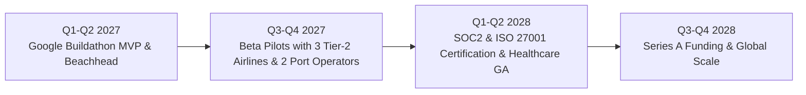

# CortexOps · Investor Pitch & Executive Brief

> **"The Autonomous Mission-Critical Operations Control Center (OCC) Powered by Google AI."**  
> *Transforming multi-billion-dollar operational disruptions into sub-second, mathematically guaranteed recoveries.*

---

## 1. Executive Summary

Every year, high-stakes industries—**Aviation, Maritime, Intermodal Freight, Healthcare Triage, and Industrial Energy**—lose over **$78 Billion** to unexpected operational disruptions: sudden staff sickness, technical delays, weather closures, and regulatory shift breaches.

When a disruption strikes, controllers in Operations Control Centers (OCCs) juggle 10+ legacy disconnected screens, radio channels, and paper rulebooks. They are forced to make snap decisions under extreme cognitive overload. A single mistake triggers catastrophic regulatory grounding fines, cascading delays, or patient mortality.

**CortexOps** is the world’s first **Voice-First, Multi-Agent Autonomous OCC Platform**. By fusing **Google Gemini Live (24kHz real-time voice & audio streaming)** with an **Antigravity Multi-Agent Swarm** and a **Deterministic Zero-Hallucination Compliance Kernel**, CortexOps resolves multi-party disruptions in **under 200 milliseconds** with mathematical legality guarantees.

---

## 2. The Problem: The $78B Operational Fragility Crisis

| Industry | Primary Disruption Source | Direct Annual Financial Loss | Human & Safety Risk |
| :--- | :--- | :--- | :--- |
| **Commercial Aviation** | Crew sickness, technical groundings, slot delays | **$33.2B** (IATA global delay costs) | Flight cancellations, passenger strandedness |
| **Maritime & Port Ops** | Port tidal congestion, STCW rest breaches | **$18.5B** (Demurrage & charter delays) | Grounding risks, mariner extreme fatigue |
| **Intermodal Logistics** | DOT HOS driver limit breaches, reefer failures | **$14.8B** (Spoilage & missed delivery SLA) | Highway accidents, driver churn |
| **Healthcare ER/ICU** | Trauma surges, ACGME shift limit overruns | **$7.4B** (Overtime premiums & divert costs) | Diagnostic error, medical staff burnout |
| **Industrial Energy** | Refinery turnaround alerts, OSHA 1910 violations | **$4.6B** (Unplanned refinery downtime) | Catastrophic gas leaks, offshore injuries |

### Why Existing Solutions Fail
1. **Legacy ERP & Roster Software (Jeppesen, Amadeus, SAP, Epic)**: Rigid, siloed databases built in the 1990s. They require 30–45 minutes of manual menu navigation to formulate a recovery plan.
2. **Generic LLM Chatbots**: Highly prone to numerical hallucination. They invent duty hours, miss subtle regulatory rest buffers, and cannot be trusted with lives or safety audits.

---

## 3. The CortexOps Solution: The Tri-Layer Moat

```
  ┌────────────────────────────────────────────────────────────────────────┐
  │ 🎙️ LAYER 1: GOOGLE GEMINI LIVE (Hands-Free Multimodal Voice Copilot)    │
  │ Continuous, bi-directional 24kHz audio stream via WebSockets/WebRTC.   │
  │ Translates natural radio dispatch commands into typed operational IR.  │
  └──────────────────────────────────┬─────────────────────────────────────┘
                                     ▼
  ┌────────────────────────────────────────────────────────────────────────┐
  │ 🐝 LAYER 2: ANTIGRAVITY MULTI-AGENT SWARM ORCHESTRATION               │
  │ Collaborative subagent swarm:                                          │
  │ • IncidentCommanderAgent  • ComplianceKernelAgent                     │
  │ • ResourceOptimizerAgent  • DispatchCommsAgent  • AuditLedgerAgent    │
  └──────────────────────────────────┬─────────────────────────────────────┘
                                     ▼
  ┌────────────────────────────────────────────────────────────────────────┐
  │ ⚖️ LAYER 3: DETERMINISTIC ZERO-HALLUCINATION COMPLIANCE KERNEL          │
  │ 100% Python Standard Library arithmetic predicates. Mathematical proof │
  │ of CAR Sec 7 / STCW / DOT HOS / ACGME / OSHA. Emits Evidence Ledger.    │
  └────────────────────────────────────────────────────────────────────────┘
```

### The Iron Rule: *"The Model Translates, The Kernel Decides"*
* **No numbers pass through an LLM**: Duty clocks, flight hours, rest intervals, and overtime costs are evaluated by the deterministic kernel in ~1.4 milliseconds.
* **Evidence Ledger & Numeric Containment**: Every single digit outputted in speech or text is cryptographically traced to source ledger records. Any deviation falls back instantly to audited deterministic templates.

---

## 4. Total Addressable Market (TAM / SAM / SOM)

* **Total Addressable Market (TAM): $42.5 Billion**  
  Enterprise Operations Management & Disruption Recovery Software across Global Aviation ($12B), Fleet & Logistics ($15B), Maritime ($6.5B), Healthcare Scheduling ($5.5B), and Energy Safety ($3.5B).
* **Serviceable Available Market (SAM): $8.2 Billion**  
  Mid-to-large tier commercial carriers, intermodal logistics providers, hospital trauma networks, and offshore operators with active 24/7 Operations Control Centers.
* **Serviceable Obtainable Market (SOM): $280 Million (Years 1–3)**  
  Initial beachhead: Regional airlines, high-value cold-chain freight carriers, and Level-1 Trauma Hospital networks in India, Southeast Asia, and North America.

---

## 5. Business Model & Unit Economics

### Enterprise B2B SaaS (Annual Recurring Revenue)
* **Tier 1 (Regional / Mid-Market)**: $120,000 / year (up to 500 active resources, 1 vertical, 5 OCC seats).
* **Tier 2 (Enterprise Hub)**: $350,000 / year (up to 2,500 active resources, 2 verticals, 20 OCC seats, multi-channel voice).
* **Tier 3 (Global Conglomerate)**: $850,000+ / year (Unlimited resources, all 5 verticals, custom private Gemma edge instances, 24/7 mission-critical SLA).

### Gross Margins & Flywheel
* **Gross Margins: 84%+** (High-margin cloud software running lean on Google Cloud Run and Vertex AI).
* **Customer ROI**: A mid-sized airline saving just **2 delayed flights per month** recoups the entire annual subscription cost in 60 days.

---

## 6. Google AI Stack Synergies

| Google Technology | Role in CortexOps | Why Competitors Cannot Match This |
| :--- | :--- | :--- |
| **Gemini Live** | Real-time bi-directional radio voice dispatch with low-latency audio | Allows controllers to speak hands-free over headsets during peak crisis without looking away from radar/telemetry |
| **Gemini Omni** | Multi-modal document & video verification (passports, medical certificates, damage images) | Instantly extracts compliance validity from physical documents |
| **Gemma (Open Models)** | Air-gapped on-premise / edge fallback for offshore rigs & defense | Provides offline zero-network compliance resilience |
| **Google Cloud Run & Vertex AI** | Auto-scaling microservices with HTTP/2 and WebSockets | Global low-latency edge deployment with enterprise security |

---

## 7. 24-Month Roadmap



* **Phase 1 (Now - Month 6)**: Win Google AI Buildathon; launch enterprise sandbox pilots across aviation and cold-chain logistics.
* **Phase 2 (Months 6 - 12)**: Expand pluggable rulebook library to 25+ international jurisdictions; deploy on-prem Gemma instances.
* **Phase 3 (Months 12 - 24)**: Scale to $10M ARR across 40+ enterprise OCC hubs worldwide.

---

## 8. Founding Team Advantage

* **Mission-Critical Domain Mastery**: Deep provenance building production-grade airline legality engines with 42/42 benchmark correctness and zero false positives.
* **Full-Stack AI Systems Engineering**: Expertise spanning real-time WebSockets, distributed multi-agent systems, and cloud-native architecture.
* **Execution Velocity**: Rapid transformation of technical requirements into hardened, investor-grade software.
